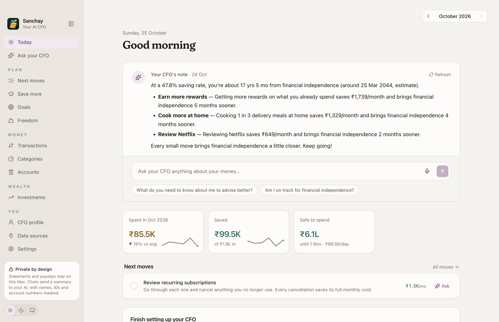
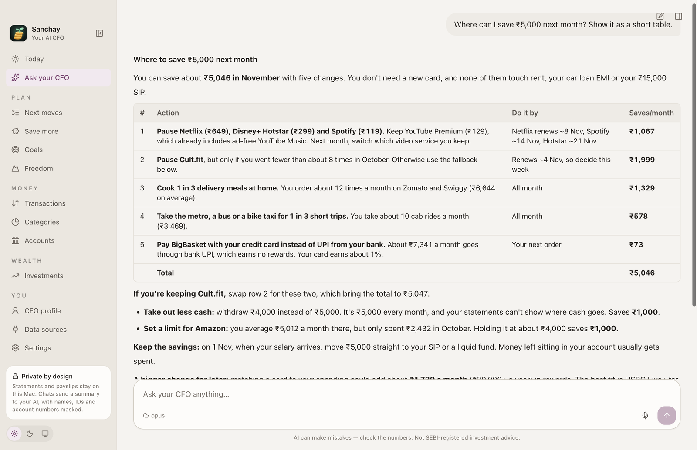
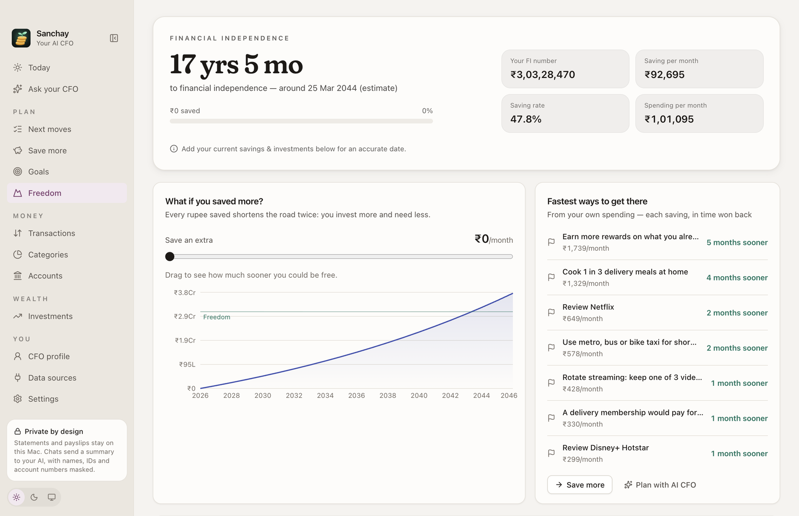
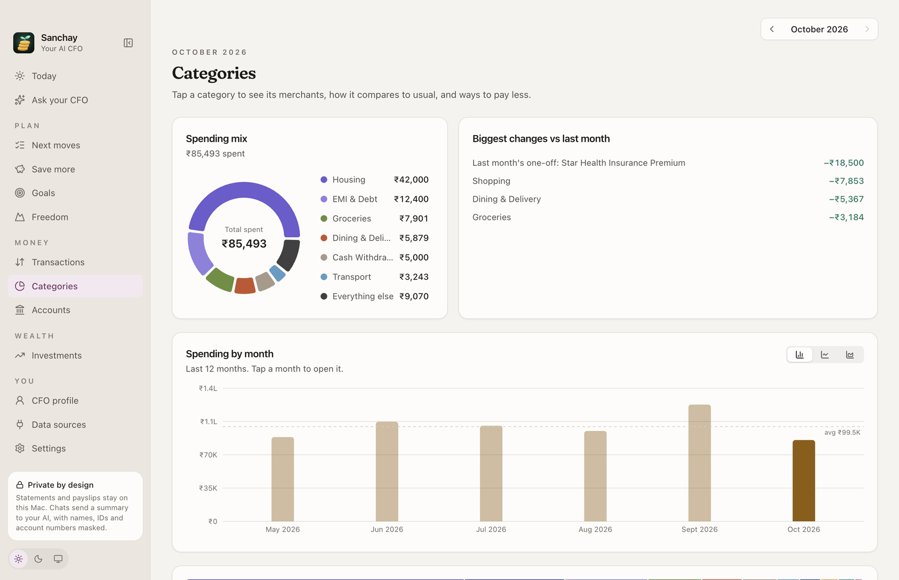

<p align="center">
  
</p>

<h1 align="center">Sanchay</h1>

<p align="center">An open-source personal finance app and AI CFO for your Mac. Import your bank statements, track your expenses, and get a money plan built from your own numbers. Your data stays on your Mac.</p>

<p align="center">
  <a href="https://github.com/ashwinsingh2007/sanchay/actions/workflows/ci.yml"></a>
  <a href="LICENSE"></a>
  
  
  <a href="https://github.com/ashwinsingh2007/sanchay/releases/latest"></a>
  <a href="https://github.com/ashwinsingh2007/sanchay/stargazers"></a>
</p>

<p align="center">
  <a href="https://github.com/ashwinsingh2007/sanchay/releases/latest"><b>Download for Mac</b></a> · <a href="https://sanchayhq.github.io">Website</a> · <a href="#demo-70-seconds">Watch the demo</a> · <a href="CONTRIBUTING.md">Contribute</a>
</p>

_Sanchay_ (संचय) is Hindi for "saving up". It's a desktop app for people in India who want to see where their money goes and what to do next, without giving their bank login to anyone. It does the job of an expense tracker and a budgeting app, and adds an AI that plans with your real numbers.

> Sanchay gives budgeting and informational insights based on your data. It is not a SEBI-registered investment adviser, and nothing in it is investment, tax or legal advice.

<p align="center">
  
</p>

## Demo (70 seconds)

https://github.com/user-attachments/assets/587d5f7c-35f8-4793-9dd5-64c26d97c6b1

The same tour set to the United States, in dollars:

https://github.com/user-attachments/assets/e0208d22-14f7-414b-9c45-72190cdfb841

Sanchay is built for India first. If you pick another country during setup, it switches the currency, hides the India-only connections and adjusts the advice. The US is the first country it supports this way.

If you have used Walnut, Money Manager, YNAB or Mint, Sanchay covers the same spending tracking and budgets. The differences are that it reads the statements you already get instead of asking for your bank login, it keeps everything in a file on your Mac, it's free and open source, and it comes with an AI you can ask about your money.

## What it does

Sanchay reads bank and credit-card statements (PDF or CSV, including password-protected PDFs), payslips, and consolidated account statements from CAMS, KFintech, NSDL and CDSL. It works out the columns, date format and signs on its own, and merges duplicates when statements overlap.

From those it closes your month: income, spending, saving rate, what changed since last month and why, recurring commitments, money leaks, and an estimate of what you can safely spend before your next payday. One-off payments are kept apart from real trends.

The planning pages turn that into next moves in priority order, goals, savings ideas sized from your own spending, and a financial-independence date. Each saving also shows how much sooner it gets you there.

The CFO review looks at your investments: allocation against a target for your age and risk, concentration in single stocks and sectors, fund costs, and gaps in your emergency fund and insurance.

"Ask your CFO" is a chat about your numbers. It can look up live market data and answers with tables, sources and the maths behind them.

Sanchay can also connect read-only to INDmoney, to brokers (Zerodha, Groww, Dhan, Upstox, FYERS, Kotak Neo) and to market-data services (Tapetide, TradingView) through their official MCP servers. Any tool that could place an order or change something is blocked.

<table>
  <tr>
    <td></td>
    <td></td>
    <td></td>
  </tr>
  <tr>
    <td align="center">Ask your CFO</td>
    <td align="center">Freedom</td>
    <td align="center">Categories</td>
  </tr>
</table>

All screenshots use the built-in sample data.

## Privacy

Your data lives in a SQLite database in `~/Library/Application Support/Sanchay/`. Sanchay has no server, no accounts, no telemetry and no analytics.

Data leaves your Mac only through features you turn on:

| You turn on                                         | What is sent                                                                                                                                                                                                | Sent to                       |
| --------------------------------------------------- | ----------------------------------------------------------------------------------------------------------------------------------------------------------------------------------------------------------- | ----------------------------- |
| A cloud AI (Claude, Gemini, OpenAI, or Claude Code) | A summary of your finances and your chat messages. PAN, Aadhaar, account and card numbers, IFSC codes, UPI IDs, email addresses, phone numbers and your employer's name are masked first. Amounts are kept. | The provider you chose        |
| A local AI (Ollama)                                 | Nothing. The model runs on your Mac.                                                                                                                                                                        | Nobody                        |
| A data source (INDmoney, a broker, market data)     | Read-only requests using your sign-in                                                                                                                                                                       | That service                  |
| Live offers                                         | Merchant names and your country                                                                                                                                                                             | Your AI provider's web search |

The app window can't reach the internet. It cancels every request except those for the bundled app, so network calls happen only in the main process and only for the services above. API keys and sign-in tokens are encrypted with the macOS Keychain (`safeStorage`). The database itself is not encrypted by the app, so turn on FileVault.

## Download

Get the latest `.dmg` from [Releases](https://github.com/ashwinsingh2007/sanchay/releases), open it and drag Sanchay to Applications. It runs on Macs with Apple silicon (M1 or later), and it's signed and notarized by Apple, so it opens without warnings.

## Quick start

To run it from source instead:

You need macOS, Node.js 22 or later (tested on 24) and npm.

```bash
git clone https://github.com/ashwinsingh2007/sanchay.git
cd sanchay
npm install          # also rebuilds better-sqlite3 for Electron
npm run dev          # launches the app with hot reload
```

On first launch, pick "Use sample data to explore the app" to load six months of made-up statements. You can also import your own, or one of the files in `fixtures/`.

> If `npm run dev` fails with "Electron failed to install correctly", run `node node_modules/electron/install.js`, then `npx electron-builder install-app-deps`.

## Scripts

| Script                            | What it does                                                                                                                        |
| --------------------------------- | ----------------------------------------------------------------------------------------------------------------------------------- |
| `npm run dev`                     | Run the app in development (hot reload)                                                                                             |
| `npm run build`                   | Typecheck, then production build into `out/`                                                                                        |
| `npm start`                       | Run the production build                                                                                                            |
| `npm test`                        | Unit tests (Vitest)                                                                                                                 |
| `npm run lint` / `npm run format` | ESLint / Prettier                                                                                                                   |
| `npm run db:generate`             | Generate a SQL migration after editing `src/main/db/schema.ts`                                                                      |
| `npm run fixture`                 | Regenerate the synthetic fixture CSVs in `fixtures/`                                                                                |
| `npm run dist`                    | Build an unsigned macOS `.dmg`                                                                                                      |
| `npm run release:mac`             | Build a signed, notarized `.dmg` (maintainers only: needs the Developer ID certificate and a `sanchay-notarize` notarytool profile) |

## Architecture

The app is built with Electron, React 19, Tailwind v4 and SQLite (through Drizzle). The financial logic is pure TypeScript in `src/shared/domain`. It has unit tests, and both processes use the same code.

```
src/
  shared/            Pure TypeScript — no Electron, no Node APIs
    domain/          Statement parsing (CSV, PDF tables, CAS, payslips), dedupe, categorisation,
                     recurring, cash flow, safe-to-spend, goals, FI, CFO review, masking (redact.ts)
    knowledge/       India investing playbook and savings-scheme rates the AI works from
    money.ts         Integer minor-unit money maths (no floats)
    ipc.ts           Typed API contract + Zod schemas
  main/              Electron main process — the only place with files, SQLite and network
    index.ts         Window, security hardening, network lockdown, start-up screen
    ai/              AI providers (Anthropic, Gemini, OpenAI, Ollama, Claude Code), chat, briefing, offers
    mcp/             Data sources over MCP (OAuth), tool hub, local tools, Claude Code bridge
    indmoney.ts      INDmoney sync and enrichment
    portfolio.ts     One portfolio from INDmoney or CAS statements
    db/              Drizzle schema and SQL migrations
  preload/           contextBridge: exposes the typed `window.cfo` API only
  renderer/          React UI (pages, components, themes)
resources/           App icon (icon.svg is the source)
```

The window runs with `contextIsolation` and `sandbox` on and `nodeIntegration` off, under a strict CSP. The main process validates every IPC payload with Zod and blocks new windows and navigation. The microphone is allowed only for dictation, and only on the app's own page. CSV exports escape cells that a spreadsheet would treat as formulas. Money is stored as whole paise with an explicit currency.

## Financial independence

The Freedom page (`src/shared/domain/fi.ts`) works out your FI number as yearly spending divided by a safe withdrawal rate. The default rate is 4%, which means 25 times a year's spending. It shows your progress from savings and investments, an estimated FI date, a projection chart, and a slider for saving more each month. You can change the expected return, the withdrawal rate and the target spending.

Each saving is shown as time won back, for example "₹7,051/month → free 1 yr 8 mo sooner". A saving helps twice: it lowers the spending your savings must cover and raises what you put away.

The Save more page sizes cheaper alternatives from your own spending (`alternatives.ts`). It compares cooking with delivery, public transport with cabs, a monthly stock-up with quick-commerce, and home coffee with cafés. It also suggests rotating streaming services and waiting 48 hours before shopping. The same page lists live offers and coupons, subscriptions you could cut, and card rewards. Totals never count a category twice.

Live offers (`src/main/ai/offers.ts`) come from the web search built into your cloud model (Claude's `web_search` or Gemini's Google Search). Only merchant names and your country are sent. An offer is kept only if it has a source link, and the model is not allowed to invent coupon codes.

The weekly briefing on the home page (`src/main/ai/briefing.ts`) lists this week's money moves. The model only words figures the app has already calculated, and a check drops any reply that mentions an amount not in those figures.

## PDF statements

PDFs are read on your Mac with pdf.js. `src/shared/domain/pdfTable.ts` rebuilds each table from the position of the text, so values land under the right column header even when cells are blank. It also joins headers and descriptions that wrap onto a second line, and drops headers repeated at the top of every page.

Password-protected PDFs ask for the password, use it once and never save it. Scanned PDFs, which contain only images, are detected and explained.

Before importing, every file (PDF or CSV) is checked to see whether it is a statement at all (`classify.ts`), by looking for dated amounts and the words statements use. Borderline files go to a local model only, never a cloud one.

## How the numbers are calculated

| Metric                   | Definition                                                                                                                                                                                                                                                                                                                                                                                                                  |
| ------------------------ | --------------------------------------------------------------------------------------------------------------------------------------------------------------------------------------------------------------------------------------------------------------------------------------------------------------------------------------------------------------------------------------------------------------------------- |
| Income                   | Sum of transactions categorised as income. Transfers are excluded.                                                                                                                                                                                                                                                                                                                                                          |
| Spending                 | Outflows in spending categories. Refunds reduce spending. Transfers and Investments & Savings are excluded; investments are shown separately as "moved to investments".                                                                                                                                                                                                                                                     |
| Net cash flow / surplus  | `income − spending`                                                                                                                                                                                                                                                                                                                                                                                                         |
| Saving rate              | `(income − spending) / income × 100`. Shows `—` when income is zero.                                                                                                                                                                                                                                                                                                                                                        |
| Month-over-month         | `currentMonthCategorySpend − previousMonthCategorySpend`. Only changes of at least 2% of monthly spending are shown. Large one-off payments are listed separately so they aren't mistaken for trends.                                                                                                                                                                                                                       |
| One-off                  | Spending of at least 10% of the month and at least 3× the month's median transaction, from a merchant not seen in the previous 3 months (or a known quarterly or yearly commitment). Rent, EMIs, groceries, dining and transport are never one-offs.                                                                                                                                                                        |
| Safe to spend (estimate) | `max(0, availableCash − commitmentsBeforeNextIncome − emergencyBuffer)`. Available cash is the balance of your bank and cash accounts, entered by you or taken from a statement's balance column. Commitments are the recurring payments you haven't ignored that fall between today and the day before your next income. Without a balance or an income date, the app asks you to set them up instead of showing a number. |
| Recurring detection      | For each merchant, take the largest group of amounts within a tolerance (15% by default). Accept it if the median gap is monthly (25 to 36 days), quarterly (80 to 100) or yearly (345 to 385), at least 60% of the gaps fit, and there are at least 3 payments (2 for yearly, capped at 60% confidence). Frequent spending that varies, such as food delivery, is rejected.                                                |
| Goals (estimate)         | Needed per month is the remaining amount divided by the whole months left before the target date. The projected finish uses your planned monthly contribution. No returns, interest or inflation are assumed.                                                                                                                                                                                                               |

### CFO actions

These come from fixed rules, not a language model. Each one shows what to do, the estimated impact, why it was suggested, the calculation, the transactions behind it, and a confidence level when it's inferred.

1. Review recurring subscriptions: the monthly cost of the subscriptions it found.
2. Fixed commitments are high before next income: commitments are at least 40% of available cash, or leave you short of your buffer.
3. A category is above its normal range: more than 125% of your average for the previous 3 months (with at least 2 months of data), leaving out one-offs on both sides.
4. A savings goal needs ₹X more per month: the gap between what's needed and what you planned.
5. Large one-off expense: marked as not a trend, with a suggested amount to set aside each month.
6. Fees and charges: bank and card charges you could avoid.
7. Below your monthly savings target: shown when you have set a target.
8. Uncategorised transactions to review.

Dismissed actions are remembered per month.

### Categorisation

Each transaction goes through three providers in order. `UserRuleProvider` applies your own "always categorise as..." rules, in priority order, matching by `contains | exact | regex`. `KeywordProvider` has about 110 built-in rules covering around 350 Indian and global merchants, with whole-word matching that also checks whether money went in or out. `FallbackProvider` assigns a low-confidence category and marks it as needing review. Any other `CategorisationProvider` can be added before the fallback, which is where an on-device model would go.

## Importing CSVs

You don't map columns by hand. An import goes through these steps:

1. Auto-mapping (`src/shared/domain/autoMap.ts`) finds the header row (even after a bank's preamble) and the delimiter. It finds the date, description, amount (or debit and credit) and balance columns from the header names, or from the values when the headers are unfamiliar. It then works out the date order and which sign means money out, checking against the statement's running balance when there is one and against `Dr`/`Cr` markers or all-positive card exports when there isn't.
2. The guess is accepted only if at least 90% of rows parse and the amounts agree with the running balance.
3. If that check fails and a local model is set up, Ollama proposes a mapping, which has to pass the same check. Statement rows are never sent to a cloud model for this.
4. Only if all of that fails does the "Check the columns" screen appear. After any automatic import, "Something look wrong?" undoes it and opens that screen.
5. The statement goes into an account. An identical file, or a statement whose rows mostly exist already, goes into the matching account. Otherwise Sanchay creates a new account named from the file (`HDFC_Statement_Sep2026.csv` becomes "HDFC") and decides whether it's a bank account or a card.

### Duplicates

`src/shared/domain/dedupe.ts` treats a row as a duplicate when it has the same signed amount, a date within one day, and a similar description. It ignores reference numbers, spacing and truncation, so a different export of the same statement still matches. Each row can match only one other row, so two identical coffees bought on the same day are both kept.

`src/main/duplicates.ts` cleans up after every import and when the app starts. It removes an import whose rows almost all exist elsewhere (the same statement imported twice, even into another account), keeps one copy of each transaction when statements in the same account overlap, and removes accounts left empty.

Supported date formats include `2026-09-01`, `01/09/2026`, `09/01/2026`, `01-Sep-2026`, `1 Sept 26`, `Sep 1, 2026` and `20260901`, each with or without a time after it.

## Contributing

Issues and pull requests are welcome. [CONTRIBUTING.md](CONTRIBUTING.md) explains how to set up, which checks to run and how to keep personal data out of reports. Please follow the [Code of Conduct](CODE_OF_CONDUCT.md), and report security problems privately as described in [SECURITY.md](SECURITY.md).

## License

Sanchay is licensed under the [GNU AGPL-3.0](LICENSE). You can use, study, change and share it. If you distribute it, or run a modified version as a service for other people, you have to publish your source under the same licence.

Parts of the CAS parser are adapted from [casparser](https://github.com/codereverser/casparser) (MIT).
